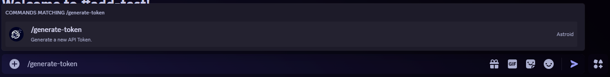

# Getting an endpoint token

## Use the token you get when registerting

When you register your Discord server at Astroid, you automatically receive a token that you can use.

See [this guide](https://app.gitbook.com/s/iOri2iEmZWVc3tKn8IRq/get-started/first-steps#step-2-register-your-server).

**If you forgot or didn't save your token, you can use the option below.**

## Generateing a new token

You can get a token by executing the <mark style="color:purple;">`/generate-token`</mark> command in your Discord server.

<figure><figcaption></figcaption></figure>

After a succesful generation of a new token you should receive a message like this:

<figure><figcaption></figcaption></figure>
